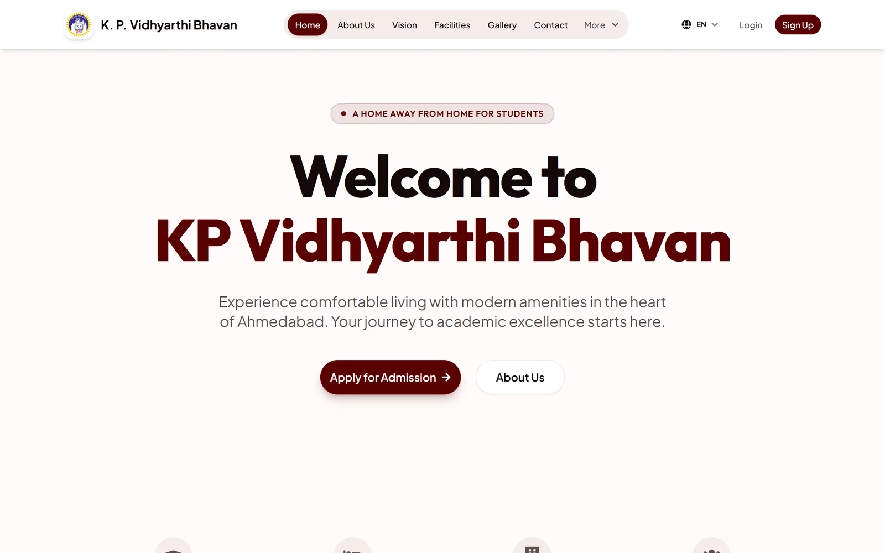
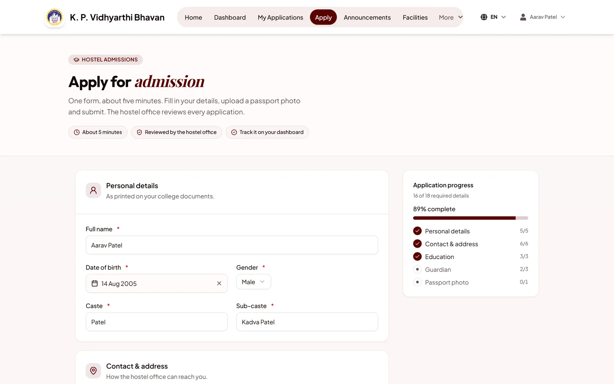
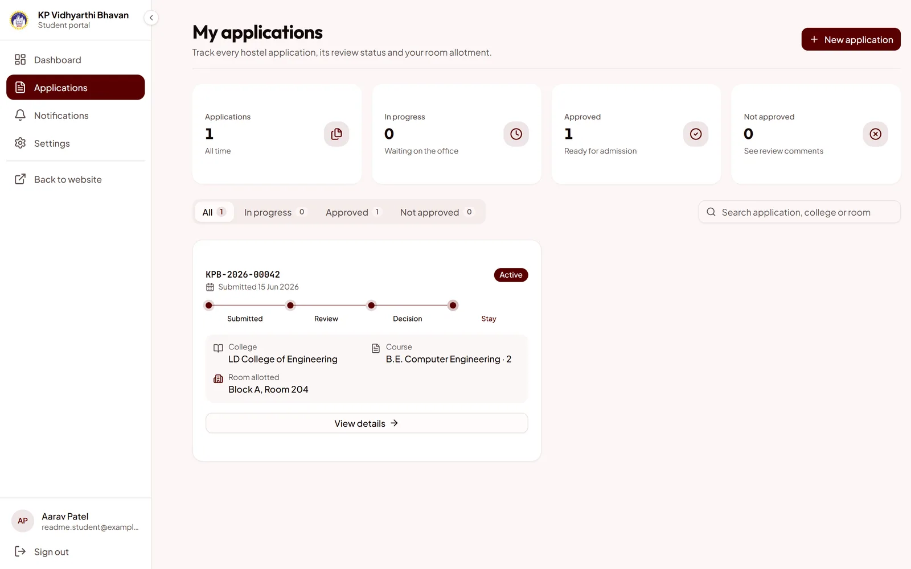
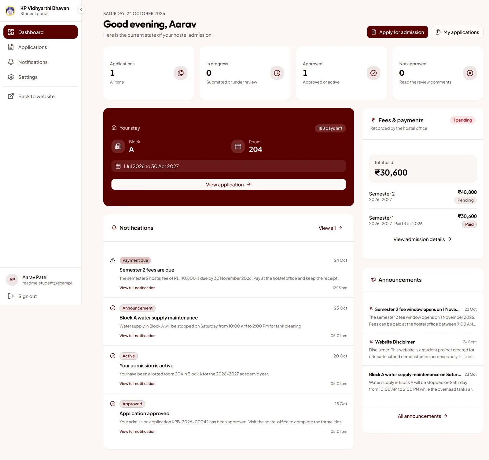
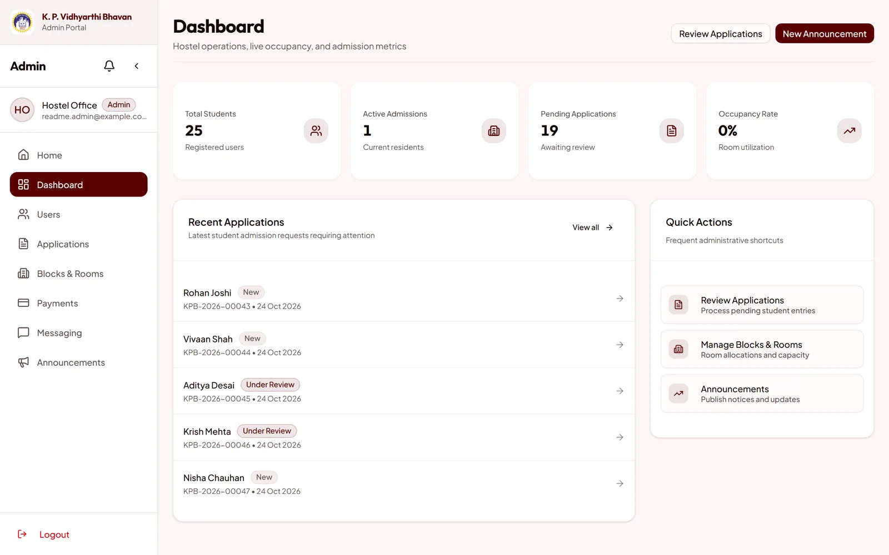
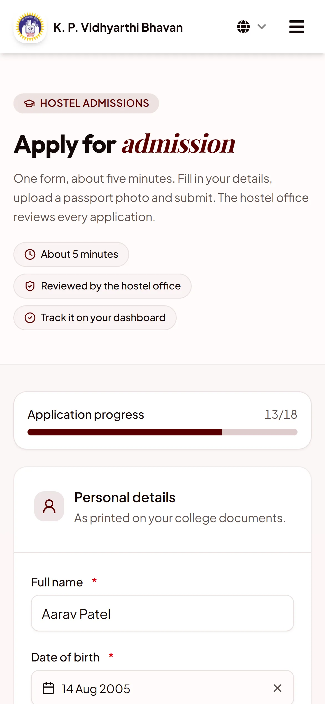

# K. P. Vidhyarthi Bhavan

[](https://nextjs.org/)
[](https://react.dev/)
[](https://www.typescriptlang.org/)
[](https://tailwindcss.com/)
[](https://neon.tech/)
[](https://next-auth.js.org/)
[](https://orm.drizzle.team/)

Public website and hostel management system for K. P. Vidhyarthi Bhavan, a students' hostel in
Ahmedabad. The public site presents the hostel in English and Gujarati and takes admission
applications online; the student and admin portals then handle review, allotment, fees and
announcements.

**Live:** [kpbhavan.vercel.app](https://kpbhavan.vercel.app)



## Screenshots

| Admission application | Student applications |
| --- | --- |
|  |  |

### Student dashboard



### Admin dashboard



### Mobile



## Features

### Public website

- Home, about, vision, facilities and gallery pages, written in English and Gujarati with
  locale-aware typography and metadata.
- Public announcements and a contact form.
- Legal pages (privacy, terms, cookies, disclaimer, credits) kept in English only.

### Admission

- A single form covering personal, contact, education and guardian details, validated with Zod.
- Profile details are pre-filled for signed-in applicants, and the progress panel shows which
  sections are still incomplete.
- Passport photo upload to Cloudinary with size and type checks.
- Every submission gets a sequential application number (`KPB-<year>-00001`) and appears in the
  student portal immediately.

### Student portal

- Dashboard with application counts, the current room and admission dates, fee status and the
  latest notifications.
- Application list with status filters and search, plus a detail view with a status timeline.
- Notification centre with read / unread filters.
- Settings for profile details, avatar, notification preferences and account deletion.

### Admin portal

- Dashboard with student counts, active admissions, pending applications, occupancy and the newest
  applications.
- Application review with approve / reject decisions, then admission activation that assigns the
  block, room and admission period.
- Blocks and rooms with capacity, occupancy, amenities and semester fees.
- Semester fee records with demand draft details and payment status.
- Announcements with rich text, pinning, target audience and expiry, a student messaging view and
  user management.

### Notifications and email

- In-app notifications for submissions, approvals, rejections, admissions and payments.
- Transactional email through Nodemailer for registration, application updates and activation.

## Tech stack

| Layer | Technologies |
| --- | --- |
| **Frontend** | Next.js 16 (App Router), React 19, TypeScript, Tailwind CSS v4, shadcn/ui, next-intl, TanStack Query, React Hook Form, Zod, motion |
| **Backend** | Next.js route handlers, NextAuth.js v4 with JWT sessions, Drizzle ORM, Neon serverless Postgres, Zod |
| **Services** | Cloudinary for image uploads, Nodemailer over Gmail SMTP for email |
| **Tooling** | Bun, Drizzle Kit, ESLint, Vercel |

Authentication supports email and password (bcrypt) plus Google OAuth. Authenticated API routes
verify the session and the `student` / `admin` role on the server.

## Getting started

### Requirements

- [Bun](https://bun.sh) 1.x
- A [Neon](https://neon.tech) Postgres database
- A [Cloudinary](https://cloudinary.com) account for image uploads
- A Google OAuth client and a Gmail app password if you want social sign-in and email delivery

### Setup

```bash
git clone https://github.com/imprince26/KP-Hostel.git
cd KP-Hostel
bun install

# create .env.local with the variables listed below
bunx drizzle-kit push              # create the tables

bun run dev
```

The app runs at [http://localhost:3000](http://localhost:3000). To use the admin portal, register an
account and set its role in the database:

```sql
UPDATE users SET role = 'admin' WHERE email = 'you@example.com';
```

### Environment variables

| Variable | Purpose |
| --- | --- |
| `DATABASE_URL` | Neon Postgres connection string |
| `NEXTAUTH_SECRET` | Secret used to sign session tokens |
| `NEXTAUTH_URL` | Canonical app URL, e.g. `http://localhost:3000` |
| `GOOGLE_CLIENT_ID` / `GOOGLE_CLIENT_SECRET` | Google OAuth credentials |
| `CLOUDINARY_CLOUD_NAME` / `CLOUDINARY_API_KEY` / `CLOUDINARY_API_SECRET` | Image uploads |
| `EMAIL_USER` / `EMAIL_PASSWORD` | Gmail address and app password |
| `EMAIL_FROM` | Sender shown on outgoing email |
| `NEXT_PUBLIC_APP_URL` | Public URL used in links inside emails |

### Scripts

| Command | Description |
| --- | --- |
| `bun run dev` | Development server with Turbopack |
| `bun run build` | Production build, including type checks and prerendering |
| `bun run start` | Serve the production build |
| `bun run lint` | ESLint |
| `bun run typecheck` | `tsc --noEmit` |
| `bunx drizzle-kit generate` | Generate a migration after editing `lib/db/schema.ts` |
| `bunx drizzle-kit push` | Apply the schema to `DATABASE_URL` |
| `bunx drizzle-kit studio` | Browse the database in Drizzle Studio |

Schema changes are applied with `drizzle-kit push`; the Vercel build does not run migrations.

## Project structure

```
app/[locale]/     public pages (en, gu)
app/(legal)/      legal pages, English only
app/student/      student portal
app/admin/        admin portal
app/api/          route handlers
components/       UI primitives and feature components
lib/              auth, database schema, API client, helpers
messages/         en.json and gu.json
proxy.ts          next-intl locale routing
```

## Notes

This is an independent project by [Prince Patel](https://github.com/imprince26).
It is not the official website of K. P. Vidhyarthi Bhavan, and nothing here should be read as an
official statement from the hostel. Screenshots use a sample account; the hostel photographs in
`public/` belong to K. P. Vidhyarthi Bhavan and are credited on the gallery page and `/credits`.
